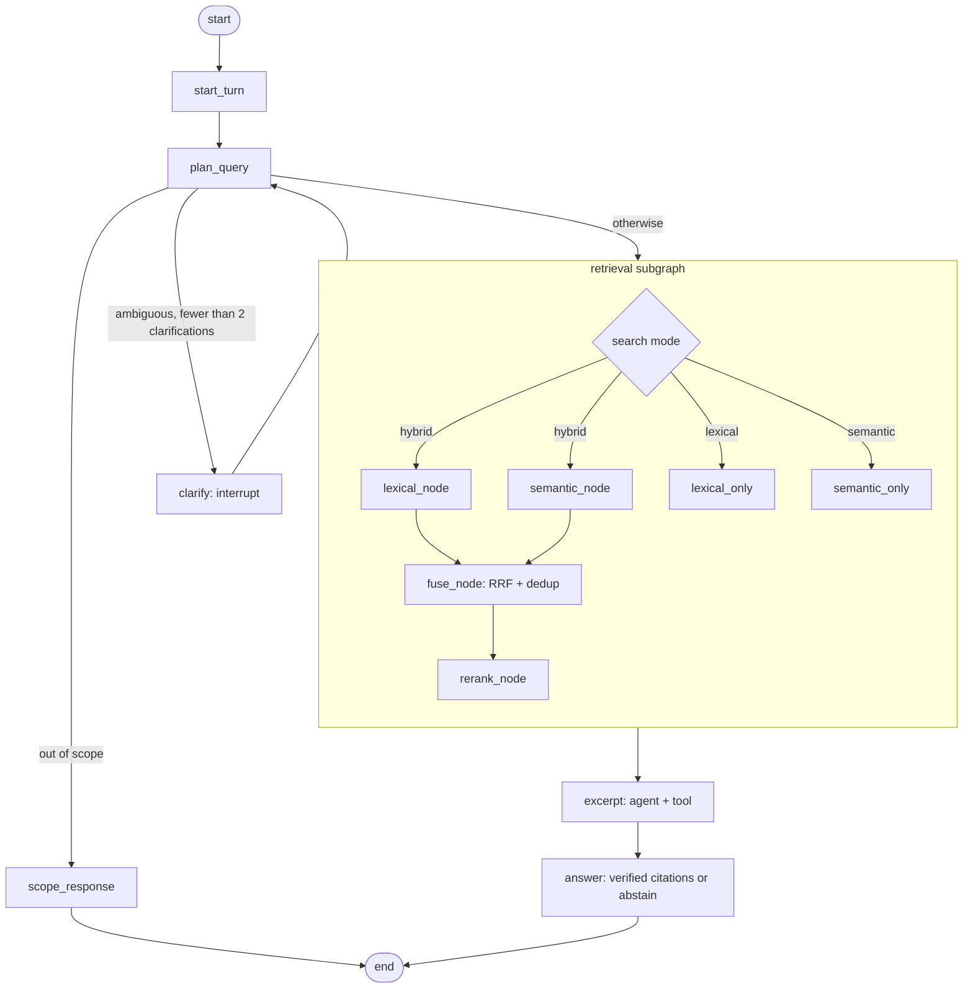

# Roads and Transport Knowledge Assistant

A backend that answers questions about Dubai **Roads and Transport** legislation using only the documents it has indexed. It searches 45
official documents (keyword, vector or hybrid), answers with citations to the exact document and page, says "insufficient evidence" instead
of guessing, remembers each conversation, and asks a clarifying question when a question is too vague.
Built with Python, FastAPI, LangChain, LangGraph and Pydantic. A React frontend (TAREEQ) is in `frontend/`.

> **Not legal advice.** The documents are a limited set, not exhaustive, and not guaranteed to be legally current.

## Folder structure

```
.
├── app/                  the backend
│   ├── api/              FastAPI routes (main.py)
│   ├── schemas/          Pydantic models for requests, responses and model output
│   ├── ingestion/        PDF -> clean text -> chunks -> SQLite
│   ├── retrieval/        filters, keyword and vector search, fusion, reranking
│   ├── graph/            the LangGraph workflow: planning, retrieval, tool step, answer
│   ├── chat.py           runs or resumes one conversation thread
│   └── config.py, errors.py, llm.py, indexing.py
├── frontend/             React + Vite page
├── tests/                184 automated tests (fake models, no network needed)
├── scripts/              manifest and download scripts, and scripts that regenerate the evidence
├── data/                 manifest.csv, eval_questions.json, download_log.csv (committed);
│                         PDFs, parsed text and SQLite files are created locally and git-ignored
├── evidence/             test evidence, the exported graph, test results
├── docs/                 project notes
├── requirements.txt      pinned dependencies
└── .env.example          settings template
```

## Setup and run

Needs Python 3.13 and an OpenAI-compatible endpoint with a chat model and an embedding model (tested with Azure AI Foundry).
```
python -m venv .venv
.venv\Scripts\activate
pip install -r requirements.txt
copy .env.example .env          # fill in AZURE_OPENAI_ENDPOINT and AZURE_OPENAI_API_KEY; .env is git-ignored
python -m pytest -q             # 184 passed; no key needed
python -I scripts/download_pdfs.py data/manifest.csv data/raw data/download_log.csv   # one time: the 45 PDFs listed in the manifest
python -m uvicorn app.api.main:app --port 8010                                         # start the API from the project root
curl -X POST http://127.0.0.1:8010/ingest                                              # one time: parse, chunk and embed
```
Interactive API docs: http://127.0.0.1:8010/docs. Frontend (Node 20.19+ or 22.12+): `cd frontend`, `npm install`, `copy .env.example .env`,
`npm run dev` -> http://localhost:5180.

Dependencies are pinned to exact versions (fastapi 0.163.1, pydantic 2.14.3, langchain 1.5.2, langgraph 1.2.23, langgraph-checkpoint-sqlite 3.1.3,
langchain-openai 1.8.1, rank-bm25 0.2.2, pypdf 7.1.0, numpy 2.5.5). A fresh environment built from `requirements.txt` passes `pip check`
and all tests.

### Models and configuration
Chat model `gpt-4.1-mini` (planner, reranker, answer, tool agent; temperature 0, 30 s timeout, 2 retries) and embeddings
`text-embedding-3-small` (batches of 64). Settings come from environment variables or `.env` (see [.env.example](.env.example)):

| Variable | Meaning | Default |
|---|---|---|
| `AZURE_OPENAI_ENDPOINT`, `AZURE_OPENAI_API_KEY` | endpoint and key (a `SecretStr`: never printed or logged) | none |
| `EMBEDDING_ENDPOINT` | only if embeddings use another endpoint | the endpoint above |
| `CHAT_DEPLOYMENT`, `EMBEDDING_DEPLOYMENT` | model names | `gpt-4.1-mini`, `text-embedding-3-small` |
| `CHUNK_SIZE`, `CHUNK_OVERLAP` | chunking, in characters | 1000, 150 |
| `RETRIEVAL_CANDIDATES` | candidates per retriever, and the most the reranker sees | 20 |
| `DB_PATH`, `CHECKPOINT_DB_PATH` | SQLite files for chunks and for conversation memory | `data/index.sqlite`, `data/checkpoints.sqlite` |
| `CORS_ORIGINS` | web page origins allowed to call the API (comma-separated, no wildcard) | `http://localhost:5180` |

Without credentials the API still starts: `/health` reports `model_configured: false` and endpoints that need a model return 503.

## Architecture and graph

```
Browser / curl --HTTP--> FastAPI (app/api)            routes only; CORS; maps errors to 409/502/503/422
                            -> app/chat.py            one thread = one conversation; one run per thread at a time
                            -> LangGraph (app/graph)  typed state, nodes, conditional edges, retrieval subgraph, tool agent
                                 |-> app/retrieval    BM25 + vectors over  data/index.sqlite
                                 '-> SQLite checkpointer  data/checkpoints.sqlite  (conversation memory, pending interrupts)
```

The exact graph exported from the compiled object is [evidence/graph.mmd](evidence/graph.mmd); this is the simplified version:

1. `start_turn` resets everything that belongs to one question.
2. `plan_query` asks the chat model (with the thread history) for a validated `QueryPlan`: intent, standalone query, filters, whether to clarify.
   If planning fails, the question is searched as written.
3. A conditional edge sends out-of-scope questions to a fixed refusal, ambiguous ones to `clarify`, the rest to retrieval.
4. `clarify` calls LangGraph's `interrupt()`; `POST /chat/resume` continues it with the same `thread_id` and the reply goes back to the planner.
   At most 2 clarifications per question.
5. In hybrid mode `lexical_node` and `semantic_node` run in parallel, each writing its own state key; `fuse_node` waits for both, merges and
   de-duplicates; `rerank_node` reorders.
6. `excerpt` is a LangChain agent with one tool and middleware. 7. `answer` produces verified citations or `insufficient_evidence`.

**State.** `messages` persist for the whole thread (an appending reducer) and are the conversation memory. `search_mode`, `filters` and `top_k` are
overwritten each request. Everything else (`plan`, `standalone_query`, candidates, `fused`, `evidence`, `status`, `answer`, `citations`,
`clarification_attempts`, ...) is reset by `start_turn` at the start of each question so nothing leaks from the previous one. The two
retrieval branches write different keys, so no reducer is needed; [evidence/AT-05_join_demo.txt](evidence/AT-05_join_demo.txt) shows the
join waits for both branches and runs once.

## Data and ingestion

**Corpus.** All 45 results of the Dubai Legislation Portal's "Roads and Transport" primary-category filter (Law 4, Regulation 3, Resolution 38;
years 2006-2026). [data/manifest.csv](data/manifest.csv) lists them with `doc_id`, title, `source_url` (portal HTML view), `content_url` (PDF),
category, language, type, number, year, authority, status, issue date and retrieval date; blank means "not on the portal", never guessed.
The filter is shown in [screenshot 1](evidence/Using_Primary_Filter_1.png) and [2](evidence/Using_Primary_Filter_2.png); the manifest loader
rejects any record outside the category ([evidence/AT-01_manifest_validation.txt](evidence/AT-01_manifest_validation.txt)).

**Reproduce it.** Tick "Roads and Transport" on the [portal](https://dlp.dubai.gov.ae/en/Pages/LegislationSearch.aspx) (not "Traffic"), save the
results page into `data/source_pages/`, then
`python -I scripts/build_manifest.py "data/source_pages/Legislation Search Engine.html" data/manifest.csv` and the download command above
(only the manifest's URLs, one at a time, 3 attempts, `%PDF` check, result logged in `data/download_log.csv`). The PDFs are not redistributed.

**What `POST /ingest` does.**
1. Parse each PDF page by page (pypdf). A failing document is reported in `errors`, never silently dropped.
2. Clean: remove header/footer lines that repeat on at least half the pages, and page-number lines. Short repeats such as `AED` in a fee table are kept.
3. Chunk **article-first**: a heading `Article (n)` alone on its line starts a chunk. Articles longer than 1000 characters are split with
   `RecursiveCharacterTextSplitter` (overlap 150) so no text is lost at a cut. Text before the first article is its own chunk.
4. Store in SQLite with stable ids `<doc_id>-<index>-<8 hex of the text hash>` (e.g. `dlp-1432-001-44caaf5f`), then embed (float32).
   Unchanged documents are skipped by fingerprint, so re-ingesting creates no duplicates.

**Ingestion report** ([evidence/AT-02_ingestion.txt](evidence/AT-02_ingestion.txt)): first run `indexed=45 skipped=0 failed=0`; second run
`indexed=0 skipped=45 failed=0`. 946 chunks, all ids distinct; length min 77 / median 715 / max 1000 characters; 332 chunks span 2+ pages.

**Stored metadata** per chunk: `chunk_id`, `doc_id`, `chunk_index`, `title`, `source_url`, `primary_category`, `locator_type` (`page`),
`page_start`, `page_end`, `article`, `text`, and when available `doc_type`, `number`, `year`, `authority`, `status` (otherwise `null`; none of
the document-level fields are missing in this corpus, `article` is null for 57 chunks). A locator is shown as `p. 13` or `pp. 1-2`.

**Three representative chunks** (from `dlp-13`, Law No. (22) of 2006 Concerning the Traffic Toll; shortened with `...`):
```
dlp-13-000-b9b3a700 | page 1 | no article | 609 chars     <- preamble before the first article
Law No. (22) of 2006
Concerning the
Traffic Toll in the Emirate of Dubai1
We, Mohammed bin Rashid Al Maktoum, Ruler of Dubai, After perusal of: ...

dlp-13-004-17e8adc1 | Article (3) | page 2 | 236 chars    <- a short article, kept whole
Article (3)
The RTA will charge motor Vehicle Owners whose Vehicles use the Road network of the Emirate and
pass through a Traffic Toll Gate in one direction a "Traffic Toll Fee", whether or not the Vehicle is
registered in the Emirate.

dlp-13-002-5a1c705e | Article (2) | pp. 1-2 | 982 chars    <- a long article, piece 1 of 2
Article (2)  The following words and expressions, wherever mentioned in this Law, will have the meaning ...
dlp-13-003-f7de5fc8 | Article (2) | page 2 | 721 chars     <- piece 2
drives it. Peak Hours: The hours during which Road traffic is at its heaviest, and which are ...
```
The last 60 characters of piece 1 also appear inside piece 2 (checked: `True`).

## Retrieval

The category "Roads and Transport" is a constant in code, not a request option. The optional filters `year` and `doc_type` are applied **before** the
top-k is chosen, in every mode; unknown fields are rejected (422).

| Mode | How |
|---|---|
| `lexical` | BM25 over the allowed chunks |
| `semantic` | cosine similarity of the query embedding with the stored chunk embeddings |
| `hybrid` | both (parallel graph nodes), then fusion, then reranking |

**Fusion is not reranking.** *Fusion* is reciprocal rank fusion, `sum of 1 / (60 + rank)` over the lists: it uses **ranks only**, never raw
scores (BM25 and cosine are on different scales), and merges duplicates by `chunk_id`. *Reranking* is one bounded LLM relevance-ranking call
on the fused candidates (at most 20): each excerpt gets an integer 0-10, excerpt text is wrapped in delimiters as untrusted data, and the final
`top_k` (1-20) is returned; if the call fails the fused order is returned and `rerank_note` says why. Example from
[evidence/AT-05_trace.txt](evidence/AT-05_trace.txt): the fused order had a document's preamble chunk first and the article with the fee
second; after reranking the article is first (score 10) and the preamble second (score 2).

Every result carries its score type and stage, and scores of different types are never compared:
`bm25` (lexical), `cosine` (semantic), `rrf` (fused_rrf), `llm_relevance_0_10` (reranked; **not** a confidence), `not_scored` (tool_excerpt).

## Answers, clarification, tool call, middleware and persistence

**Grounded answers.** The model returns statements `{text, chunk_id, quote}`. **Code verifies each one**: the `chunk_id` must be one we sent
and the quote must occur in that chunk (spacing, case and curly quotes normalised, nothing else). The answer text and the `Citation` objects
are then built by our code from verified statements and stored chunk data, so every citation resolves to a real chunk and page. With thin
evidence, or if nothing verifies, the result is `insufficient_evidence`. A cited document whose status is not "In Force" gets a note, and every
answer ends with the disclaimer. A failed model call is an error (502), not an abstention. The quote check proves the quote is in the chunk, not
that the sentence reads it correctly.
*Observed failure and fix:* on real data the model sometimes quoted across a page-break footnote, so valid answers were rejected and the
system abstained wrongly in about half the runs of one question. Fix: one bounded retry that tells the model which quotes were rejected (then 8 of 8
runs answered).

**Clarification (real interrupt).** `clarify` calls `interrupt()`; `/chat` returns `needs_clarification` with `{interrupt_id, question}`;
`/chat/resume` with the same `thread_id` and that id continues the saved run. The service checks the saved state first and returns **409**
if the thread has no pending clarification or the id differs (LangGraph itself would accept any resume), and also refuses a new `/chat`
message on a paused thread. Nothing but reading state runs before `interrupt()`, because on resume the node re-runs from its first line.
The pending interrupt survives a restart because it lives in the SQLite checkpoint.

**Tool call and middleware.** `excerpt` is a LangChain `create_agent` node. The model may call `get_document_excerpt(document_id, locator)`
to read another page; arguments are validated by a Pydantic schema, access is restricted in code to indexed Roads and Transport documents, and
returned chunks join the evidence (and are verified like any other). Middleware lives **inside the agent**: `monitor_tool_call` (`@wrap_tool_call`)
times and logs every tool call and turns a tool failure into a message the model can read; `ModelCallLimitMiddleware(3)` and
`ToolCallLimitMiddleware(2)` bound the loop. LangChain middleware runs around model and tool calls inside the agent; FastAPI HTTP middleware
(CORS in `app/api/main.py`) runs around each HTTP request and never sees them. Measured: the tool did **not** improve answers on our evaluation
and costs about 1.6 s ([evidence/AT-10_tool_effect.txt](evidence/AT-10_tool_effect.txt)); it stays, gated to messages that mention pages.

**Persistence.** A LangGraph `SqliteSaver` checkpointer saves state after every step under the `thread_id`: short-term, per-conversation memory,
not a long-term store. One run per thread at a time (a second concurrent request gets 409; in-process lock).

**Limits (all bounded).** Message 2000 characters; `top_k` 1-20 (default 5); 20 candidates per retriever; 2 clarifications; 2 answer model
calls (one retry); 5 statements per answer with quotes of at least 8 characters; tool agent 3 model calls, 2 tool calls, 2 chunks per read; model
call 30 s timeout with 2 retries; thread id `[A-Za-z0-9_-]`, 1-64 characters.

**Logging.** One INFO line per node start and end with `request_id`, `thread_id`, search mode, seconds and list sizes (never document text);
tool calls and middleware events are logged the same way. Credentials are never logged.

## API reference

Interactive docs at `/docs`. Responses below are real, shortened.

| Endpoint | Purpose |
|---|---|
| `GET /health` | `{status, model_configured, index_available}`; no secrets |
| `POST /ingest` | ingest the local corpus; `{indexed, skipped, failed, errors[], embedded, embedding_error}` |
| `POST /search` | `{query, mode, top_k, filters}` -> ranked chunks with mode, stage and labelled scores |
| `POST /chat` | `{message, thread_id?, search_mode, top_k, filters}` -> answer, abstention, refusal or clarification |
| `POST /chat/resume` | `{thread_id, interrupt_id, message}` -> continues a paused thread |

```
POST /search {"query":"departure fee airports","mode":"hybrid","top_k":2,"filters":{"year":2022,"doc_type":"Law"}}
-> {"mode":"hybrid","ranking_stage":"reranked","filters_applied":{"year":2022,"doc_type":"Law"},
    "results":[{"rank":1,"score":10.0,"score_type":"llm_relevance_0_10","stage":"reranked","chunk_id":"dlp-1432-001-44caaf5f",
                "doc_id":"dlp-1432","title":"Law No. (13) of 2022 Concerning the Dubai Airports Departure Fee","source_url":"https://dlp...",
                "locator_type":"page","locator":"pp. 1-2","article":"Article (1)","year":2022,"doc_type":"Law","status":"In Force","text":"Article (1)..."}, ...],
    "candidates_before_rerank":["dlp-1432-000-82e5035a","dlp-1432-001-44caaf5f", ...],"rerank_note":null}

POST /chat {"message":"Do I need a permit to import or sell a drone in Dubai?","thread_id":"example","search_mode":"hybrid","top_k":3}
-> {"thread_id":"example","status":"answered","answer":"No Person may import, bring in, or sell Unmanned Aircraft ... without first obtaining the relevant Permit from the DCAA [1]. ...",
    "citations":[{"document_id":"dlp-1718","chunk_id":"dlp-1718-028-083127b7","title":"Law No. (4) of 2020 Regulating Unmanned Aircraft ...",
                  "source_url":"https://dlp...","locator_type":"page","locator":"p. 13"}, ...],"clarification":null,"request_id":"d0434ae842fd"}

POST /chat {"message":"What is the fine?","thread_id":"t1"}
-> {"thread_id":"t1","status":"needs_clarification","answer":null,"citations":[],
    "clarification":{"interrupt_id":"59670c64e4be8f02d8cc5705aff45803","question":"What specific violation or law are you asking about regarding the fine?"},"request_id":"24f7f29266b0"}
POST /chat/resume {"thread_id":"t1","interrupt_id":"59670c64e4be8f02d8cc5705aff45803","message":"I mean the fees for passengers leaving through Dubai airports"}
-> {"thread_id":"t1","status":"answered","answer":"A departure fee of seventy-five dirhams (AED 75.00) ... [1]. ...","citations":[ ...3... ],"clarification":null,...}
```
`status` is one of `answered`, `needs_clarification`, `insufficient_evidence`, `out_of_scope` (the last returns a fixed message and no citations).

| HTTP | When |
|---|---|
| 422 | validation: empty or over-length message, bad `top_k`, unsupported mode, bad thread id, unknown fields, invalid filters |
| 409 | same thread already running; resume with no pending clarification or a wrong `interrupt_id`; new message on a paused thread |
| 502 | a model call failed |
| 503 | no index yet (run `/ingest`) or credentials missing |

## Tests, acceptance checklist and evaluation

`python -m pytest -q` runs 184 tests with fake models and no network (parsing and chunk metadata, filters, deduplication and fusion, routing,
schema validation, citation verification, interrupt and resume, thread isolation, CORS, tool and middleware).
[evidence/pytest_results.txt](evidence/pytest_results.txt) is a full run in a fresh environment with no `.env`, PDFs or index. Real-model evidence
is regenerated with `python -m scripts.evidence_search` (AT-03, AT-04), `python -m scripts.run_eval` (AT-12) and `python -m scripts.trace_graph`
(AT-05 to AT-10 and the graph export); these make real model calls.

### Acceptance checklist
All run on the real corpus with the real models (except the unit tests).

| Test | Result | Evidence |
|---|---|---|
| AT-01 Corpus boundary | PASS: an out-of-category record is rejected; filter screenshots show the 45 results | [AT-01](evidence/AT-01_manifest_validation.txt) |
| AT-02 Parsing, repeat ingestion | PASS: locators from 3 documents; second ingest adds nothing | [AT-02](evidence/AT-02_ingestion.txt) |
| AT-03 Search modes | PASS: same questions in all modes; differences explained, incl. where hybrid is not better | [AT-03](evidence/AT-03_search_modes.txt) |
| AT-04 Filters | PASS: year, type, both and a no-match filter in every mode | [AT-04](evidence/AT-04_filters.txt) |
| AT-05 Parallelism, reranking | PASS: branches start together, `fuse` runs once after both; order before/after rerank | [trace](evidence/AT-05_trace.txt), [join](evidence/AT-05_join_demo.txt) |
| AT-06 Grounded answer | PASS: page locators; citations resolve to stored chunks | [AT-06/07](evidence/AT-06_07_answers.txt) |
| AT-07 Abstention, scope | PASS: `insufficient_evidence` and `out_of_scope`, no invented answer | [AT-06/07](evidence/AT-06_07_answers.txt) |
| AT-08 Memory, isolation | PASS: follow-up works in thread A, thread B has no history, survives restart | [AT-08](evidence/AT-08_memory.txt) |
| AT-09 Interrupt, restart | PASS: real pause; after a restart the same `thread_id` resumes it | [AT-09](evidence/AT-09_interrupt.txt) |
| AT-10 Tool, middleware | PASS: model-issued tool call, validated arguments, result, middleware logs, controlled failure, call limit | [AT-10](evidence/AT-10_tool_middleware.txt) |
| AT-11 API, schemas | PASS: invalid input -> 422; invalid or non-pending resume -> 409 | [AT-09](evidence/AT-09_interrupt.txt), tests |
| AT-12 Retrieval evaluation | PASS: 10/10 in the top 5 in every mode (below) | [AT-12](evidence/AT-12_eval.txt) |

### Retrieval evaluation (AT-12)
Ten questions written after reading the corpus (expected documents and source passages in [data/eval_questions.json](data/eval_questions.json)).
Cells give the position (1-5) of the first chunk from the expected document in the final top 5, no filters.

| # | Question | Expected | Lexical | Semantic | Hybrid |
|---|---|---|---|---|---|
| Q01 | How much is the departure fee for passengers leaving through Dubai airports, and who is exempt from it? | `dlp-1432` | 1 | 1 | 1 |
| Q02 | Which vehicles are not subject to the traffic toll law? | `dlp-13` | 1 | 2 | 2 |
| Q03 | Do I need a permit to import or sell a drone in Dubai? | `dlp-1718` | 1 | 1 | 1 |
| Q04 | Can a driver carry passengers in a vehicle that the licensing authority has not licensed to transport passengers? | `dlp-190` | 2 | 1 | 1 |
| Q05 | Which railway violations require a written warning before a fine can be imposed? | `dlp-1739` | 5 | 1 | 1 |
| Q06 | What must the Dubai Maritime Authority do once a maritime accident has been reported to it? | `dlp-1640` | 1 | 1 | 1 |
| Q07 | At what times of day does the public parking fee apply during peak hours? | `dlp-1941` | 1 | 1 | 1 |
| Q08 | Can a vessel owner apply to renew a vessel permit without first having a technical inspection certificate? | `dlp-1655` | 1 | 1 | 1 |
| Q09 | What powers does the RTA have in relation to autonomous vehicles? | `dlp-1525` | 1 | 1 | 1 |
| Q10 | What powers does the licensing agency have over permits for vehicle technical inspection centres? | `dlp-1918` | 2 | 1 | 1 |

Failure notes: nothing was missed. Lexical ranked the expected document 5th for Q05 and 2nd for Q04 and Q10 (BM25 rewarded other documents that
repeat common words such as *violations* and *fine*; see [AT-03](evidence/AT-03_search_modes.txt)); semantic and hybrid ranked it 2nd for Q02
while lexical had it 1st, so hybrid is not always better. The questions are document-level and each is answered by one article, so they are too
easy to separate the modes or to show that reranking helps.

### Demonstration order
1. `POST /ingest` (a second call skips everything). 2. `POST /search` in the three modes. 3. `POST /chat` with a question that has an answer
(the departure-fee question above). 4. Add `{"year": 2022, "doc_type": "Law"}` filters. 5. Same `thread_id`: "Who is exempt from it?".
6. "What is the fine?" -> `needs_clarification`. 7. Restart the server, then `POST /chat/resume` with the same `thread_id` and `interrupt_id`.
8. "What is the fine for parking a camel outside a mosque in Dubai?" -> `insufficient_evidence`; "What is a good recipe for pasta carbonara?" ->
`out_of_scope`. 9. Show [evidence/graph.mmd](evidence/graph.mmd), the server log and [evidence/AT-10_tool_middleware.txt](evidence/AT-10_tool_middleware.txt).

## Known limitations

- `primary_category` comes from the portal filter that was applied; the portal does not print a category on each record. Status is copied from the portal.
- Amending resolutions quote replacement articles, so an article label can repeat across documents; amendments are not consolidated.
- A footnote at the bottom of a PDF page can fall inside an article that crosses the page break (the cause of the quote problem above); it is
  mitigated by a prompt rule and one retry, not fixed at the source. Tables are flattened to text. No OCR and no Arabic.
- The evaluation is document-level and too easy; reranking is not shown to beat fusion alone; the tool did not measurably improve answers.
- The planner's rewrite of a follow-up varies between runs. A full answer takes several seconds (about 8-10 s measured; planning, reranking and
  answering are separate model calls).
- The per-thread lock is in-process (one server process); SqliteSaver suits small single-process use. A paused thread stays paused until
  answered. Memory is per thread only; there is no long-term cross-thread memory.
- Model calls time out after 30 s with 2 retries, but there is **no overall deadline for one HTTP request**. No authentication or rate
  limiting; CORS allows only the configured origin and is meant for local use.

## Frontend

`frontend/` is a React + Vite + TypeScript page (Tailwind CSS 4, shadcn/ui, axios) that only calls the API above. Setup is in [Setup and run](#setup-and-run).
The Assistant chat works against the real API (answers with sources, clarification and resume, plain-language errors) and keeps past conversations in the browser (they continue on the same server thread, also after a server restart); the Search Inspector is next. The backend is complete without it.
